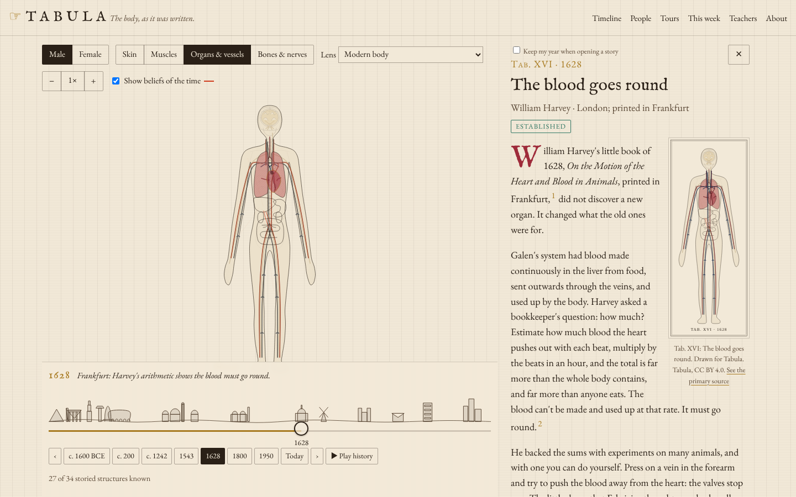

<p align="center">
  
</p>

<h1 align="center">Tabula</h1>

<p align="center">
  <b>The body, as it was written.</b><br>
  An engraved human body in which every part carries the story of who worked it out, how they did it, and what they got wrong first.
</p>

<p align="center">
  <a href="https://github.com/akhanrepo/tabula/actions/workflows/ci.yml"></a>
  <a href="https://github.com/akhanrepo/tabula/actions/workflows/codeql.yml"></a>
  <a href="https://github.com/akhanrepo/tabula/releases/latest"></a>
  <a href="LICENSE"></a>
  <a href="LICENSE-CONTENT"></a>
</p>

<p align="center">
  <a href="https://tabula-anatomy.netlify.app"><b>Open Tabula</b></a> ·
  <a href="https://tabula-anatomy.netlify.app/teachers/">Classroom packs</a> ·
  <a href="https://tabula-anatomy.netlify.app/edition/">The edition</a> ·
  <a href="#accuracy-is-a-build-gate">Accuracy</a> ·
  <a href="#quick-start">Build</a> ·
  <a href="CONTRIBUTING.md">Contributing</a> ·
  <a href="#licence">Licence</a>
</p>

<p align="center">
  
</p>

---

## Why Tabula

The history of how we came to understand the body is a great story, but it's told as linear narrative, in books, podcasts and documentaries. Nobody lays it onto the body itself, so you can't see *where* knowledge arrived, *when*, or what it overturned. Anatomy atlases ignore history, museum sites and Wikipedia are accurate but scattered, and popular retellings repeat myths and contested "firsts" without flagging them.

Tabula puts the history on the body. Drag a slider from 1600 BCE to today and watch the figure being *written in*, from the Edwin Smith papyrus's first word for "brain" to the 2018 interstitium argument. Beliefs of their time appear in red ink and are scraped away when they're overturned. Every sentence is footnoted, and the build refuses to ship a claim that isn't sourced and verified.

## Features

| | |
|---|---|
| 🫀 **The body** | Male and female engraved figures with about 40 structures, flaps for the skin, muscle, viscera and skeleton layers, and 1×/2×/4× zoom |
| 🕰️ **The slider and fog** | At any year, each structure is *unknown* (blank paper), *described* (an ink outline) or *understood* (hatched and coloured) |
| 📜 **26 discoveries** | Plates I–XXVI, each with a 150–300-word story, footnoted claims, the method used and the belief it overturned |
| 🖍️ **Misbeliefs** | Beliefs drawn in red ink that fade when challenged and are erased when corrected |
| 🧭 **Timeline, people and tours** | Six guided tours: circulation, brain and nerves, microscopy, myths and firsts, beyond Europe, hidden vessels |
| 🌏 **Traditions lens** | Islamic-Galenic, Chinese classical and Ayurvedic maps of the body, on their own terms |
| 🔗 **Sharing** | Every view is a link; Open Graph cards, a weekly `/today` and an RSS feed |
| 🍎 **Classroom packs** | Four free printable packs (A4 and US Letter): black-line plates to colour, story cards, "spot the myth", discussion questions and a sourced answer key |
| 📖 **The edition** | A free long read: one chapter of about 2,500–4,000 words per tour, with a long-view essay, the plates and a full bibliography (EPUB and PDF) |

No accounts, no cookies, no tracking unless the maintainer turns on cookieless analytics. It works without JavaScript for reading, and it is keyboard and screen-reader operable.

## Accuracy is a build gate

Every historical claim is a structured `Claim` with citations, and the build **fails** unless:

- it has ≥ 2 primary or secondary sources, with ≥ 1 scholarly secondary source (tertiary sources never count);
- contested or revised claims carry a note explaining the disagreement;
- every footnote in a story or essay resolves to a claim, and every citation to a source;
- a verification log exists for the subject, with a `claimsHash` that matches the current claims (editing a claim makes the log stale);
- image licences are on the allow-list (PD, PDM, CC0, CC BY), and balance targets hold (pre-1500, non-European, post-1900, contested, systems).

Verification is **AI-assisted**: Claude checks each claim against the [F05 method](docs/features/F05-citations-and-contested-claims.md) and writes the log, and the site says so on every story. That reduces errors but doesn't eliminate them, and some key scholarship is print-only. That is why corrections are built in: every footnote has a **Suggest a correction** link, and accepted corrections are published on [`/corrections`](https://tabula-anatomy.netlify.app/corrections/). The full method is on [`/how-we-source`](https://tabula-anatomy.netlify.app/how-we-source/).

## Quick start

Requires **Node 22**.

```bash
git clone https://github.com/akhanrepo/tabula.git
cd tabula
npm ci
npm run dev        # http://localhost:4321
```

| Command | What it does |
|---|---|
| `npm run dev` | Astro dev server |
| `npm run validate` | Content gates only (schema, citations, logs, licences, balance) |
| `npm run build` | Validate, then build the static site into `dist/` |
| `npm run preview` | Serve `dist/` |
| `npm test` | Vitest: logic, content gates, AC traceability (fast) |
| `npm run test:e2e` | Playwright smoke and functional tests against the built site |
| `npm run test:perf` | Performance budgets (payload, LCP, tap→panel, frame time, under CPU throttling) |
| `npm run test:all` | All of the above |
| `npm run lint` | `astro check` plus the design-token lint (no raw hex values) |
| `npm run artefacts` | Classroom-pack PDFs and the edition (EPUB via pandoc, PDF) into `artefacts/` |

The browser tests need Chromium: run `npx playwright install chromium` once, or point `PLAYWRIGHT_CHROMIUM_PATH` at an existing one.

## How it works

Tabula is a static [Astro](https://astro.build) site in strict TypeScript. Everything is server-rendered: every structure, story panel and misbelief is in the HTML. A small vanilla-TypeScript controller adds the slider, flaps, panel and lens. Content is YAML and Markdown in `content/`, validated with Zod by the same loader that the pages, scripts and tests use. The fog is derived, never stored: `stateAt(structure, year)` is a pure function that runs at build time and in the browser.

```
content/                 data only (YAML + Markdown), validated with Zod
  discoveries/*.md       26 plates: front matter (claims, people, structures…) + story
  essays/*.md            edition long-view essays, one per tour, same claim system
  logs/*.md              verification logs (one per subject, hash-locked to its claims)
  *.yaml                 structures, people, sources, misbeliefs, eras, threads,
                         traditions, assets, share-dates, calendar, corrections
src/
  lib/                   pure TS (no DOM): fog engine, slider scale, URL state,
                         content schema/loader/gates, packs, edition, downloads, OG…
  art/                   SVG geometry for figures, flaps, panorama and lenses, keyed by structure ID
  components/            .astro components (server-rendered)
  client/                vanilla TS enhancing the server-rendered DOM (no framework)
  pages/                 routes: /, /tab/[id], /timeline, /people, /threads,
                         /today, /teachers, /edition, /sources, /corrections…
  styles/global.css      design tokens (mirrored in tokens.ts); the only place colours are defined
  config/site.ts         brand, licences and integrations (all off until configured)
scripts/                 validation, logs, artefacts, release, static server
tests/
  unit/                  Vitest (incl. traceability: every Fxx-ACn has a test)
  e2e/smoke, e2e/functional, perf/   Playwright
docs/                    PRD, feature briefs F01–F18, plans, architecture, research
```

More in [docs/architecture.md](docs/architecture.md). The product thinking is in the [PRD](docs/PRD.md), the [feature briefs](docs/features/README.md), the [build plan](docs/PLAN.md) and the [accuracy review](docs/research/accuracy-review-2026-10.md).

## Configuration

Integrations are off until their environment variables are set (on Netlify: Site configuration → Environment variables):

| Variable | Enables |
|---|---|
| `PUBLIC_PLAUSIBLE_DOMAIN`, `PUBLIC_PRODUCTION_HOST` | Plausible analytics (cookieless; production host only) |
| `PUBLIC_CONTACT_EMAIL` | An email option for corrections and sponsorship (otherwise GitHub only) |
| `PUBLIC_DONATE_URL` | A donate button on `/support` |
| `SITE_URL` (optional) | Canonical URL, if not `https://tabula-anatomy.netlify.app` |

## Deploy and release

Netlify builds `main` (`netlify.toml`: `npm run build`, publish `dist/`). There's no server. Pushing a `vX.Y.Z` tag runs the release workflow, which builds the classroom packs and the edition and publishes them to [GitHub Releases](https://github.com/akhanrepo/tabula/releases); the site's download links always point at the latest release.

## Known limitations

- **Art:** the figure is Tabula's own schematic engraving-style drawing, standing in for a commissioned engraving. It's keyed by structure ID, so the art can be replaced one structure at a time.
- **Historical images:** each story's plate is generated from our figure and links to the primary-source record. Drop licensed scans into `public/plates/` and they're used automatically.
- **Traditions lens plates** aren't shown until each record's licence is confirmed; a labelled schematic stands in.
- Other open items are tracked in [docs/PLAN.md](docs/PLAN.md#open-items-after-the-v1-build-from-the-done-review).

## Contributing

Corrections are the most valuable contribution: use **Suggest a correction** on any footnote, and name a source. To propose a discovery, report a bug or send code, see [CONTRIBUTING.md](CONTRIBUTING.md). Everyone taking part follows the [Code of Conduct](CODE_OF_CONDUCT.md). Security issues go through [private reporting](SECURITY.md).

[`CLAUDE.md`](CLAUDE.md) is the working guide for AI coding assistants. Much of Tabula was built with Claude, and the same rules bind human and AI contributions.

## Support

Tabula is free. It's funded by sponsorship from museums, libraries, learned societies and education publishers, under a public [editorial-independence policy](https://tabula-anatomy.netlify.app/support/): sponsors never review or influence content.

## Licence

| What | Licence |
|---|---|
| **Code** (everything not listed below) | [MIT](LICENSE) |
| **Written content**: stories, essays, tour intros, misbeliefs, verification logs and the data in `content/`, plus the classroom packs and the edition generated from them | [CC BY-SA 4.0](LICENSE-CONTENT) |
| **Plates** drawn for Tabula (`kind: generated` in `content/assets.yaml`) | [CC BY 4.0](https://creativecommons.org/licenses/by/4.0/) |
| Fonts, dependencies and cited historical material | Their own licences: see [THIRD_PARTY_NOTICES.md](THIRD_PARTY_NOTICES.md) |

To reuse the content, credit **"Tabula (https://github.com/akhanrepo/tabula)"**, link the licence, say if you changed anything, and share adaptations under CC BY-SA 4.0. If you deploy a fork publicly, please give it a different name so readers don't confuse it with this project and its corrections log.
